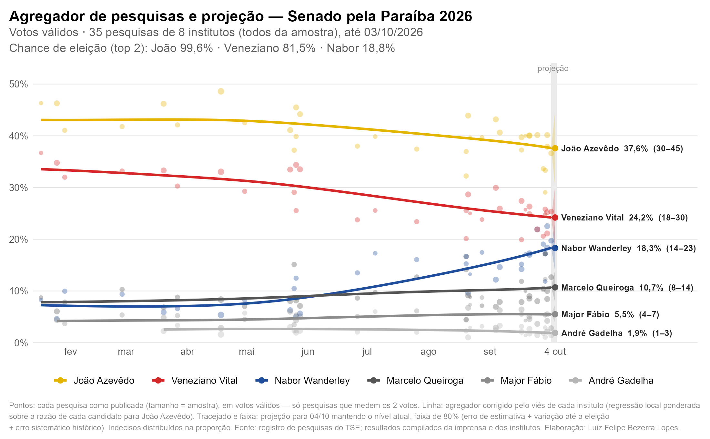

# Agregador de pesquisas — Senado PB 2026

Agregador das pesquisas eleitorais para o Senado na Paraíba (eleição de
04/10/2026, duas vagas). Ele faz quatro coisas:

- reúne as pesquisas estaduais registradas no TSE;
- coloca resultados publicados em formatos diferentes (soma dos dois votos,
  média, citações) numa medida comum;
- corrige o viés relativo de cada instituto;
- projeta a probabilidade de cada candidato terminar entre os dois mais
  votados.

A projeção usa as pesquisas publicadas até a véspera (03/10/2026). Método,
fórmulas e referências estão em [METODOLOGIA.md](METODOLOGIA.md).

### Destaques

- **Coleta com conferência.** Os resultados vêm de PDFs dos institutos e de
  portais de notícia. São coletados duas vezes, de forma independente, e
  conferidos por releitura cega. Nenhum número entra sem fonte.
- **Parâmetros testados.** A banda do kernel, o encolhimento do efeito de
  instituto e o eixo de data foram escolhidos por validação cruzada. O erro
  sistemático e a deriva da projeção foram estimados com 8 disputas anteriores
  na Paraíba (Governo e Senado, 2014–2022). Os resultados estão em
  [output/calibracao.md](output/calibracao.md).
- **Avaliação ex post.** A projeção foi comparada com o resultado oficial do TSE
  depois de fixados os parâmetros; ver
  [output/avaliacao_ex_post.md](output/avaliacao_ex_post.md).

### Resultado (pesquisas até 03/10/2026)

| Candidato | Projeção (válidos) | Faixa de 80% | Chance de eleição | Resultado oficial |
|---|---|---|---|---|
| João Azevêdo (PSB) | 37,6% | 30,1–44,9 | 99,6% | 32,5% (eleito) |
| Veneziano Vital do Rêgo (MDB) | 24,2% | 18,5–30,3 | 81,5% | 22,8% (eleito) |
| Nabor Wanderley (Republicanos) | 18,3% | 13,8–23,4 | 18,8% | 20,9% |
| Marcelo Queiroga (PL) | 10,7% | 7,8–14,0 | 0,2% | 12,5% |



Autor: Luiz Felipe Bezerra Lopes.

## Como rodar

O R fica fora do PATH e o `Rscript` trava (segfault) quando chamado pelo Git
Bash; use o PowerShell, a partir desta pasta:

```powershell
& "C:\Program Files\R\R-4.6.1\bin\Rscript.exe" programs/run_all.R          # tudo
& "C:\Program Files\R\R-4.6.1\bin\Rscript.exe" programs/run_all.R 4 5 6    # só algumas etapas
& "C:\Program Files\R\R-4.6.1\bin\Rscript.exe" tests/run_tests.R           # testes do modelo
```

Downloads e buscas ficam em cache (`data/raw/`), e rodar de novo não refaz
requisições. Esse cache tem cerca de 2 GB, sobretudo os arquivos de votação do
TSE, e não está no repositório. A primeira execução baixa tudo de novo. Os dados
conferidos à mão (`data/manual/`) e os intermediários (`data/processed/`) estão
versionados.

## Etapas

| Etapa | Script | O que faz |
|---|---|---|
| 1 | `programs/01_tse_fichas.R` | Baixa as pesquisas registradas no TSE, filtra PB + Senado e classifica a abrangência (regras + `abrangencia_manual.csv`). |
| 2 | `programs/02_busca_fontes.R` | Busca matérias nos portais da PB pela API do WordPress e as liga aos protocolos (número citado ou instituto + data). |
| 3 | `programs/03_extrai.R` | Extração semiautomática de candidato → % do texto das matérias e PDFs. |
| 4 | `programs/04_consolida.R` | Compara a coleta R com a coleta do agente, aplica a revisão, as regras de inclusão e a penalidade datada de cada instituto. |
| 5 | `programs/05_agregador.R` | Log-razão com João, pesos √n × penalidade, efeito de instituto, regressão local. |
| 6 | `programs/06_projecao.R` | 200 mil simulações, Tabela 1 e sensibilidade. |
| 7 | `programs/07_figuras.R` | Figuras 1–4 e Tabela 1 (docx) em `output/`. |
| 8 | `programs/08_avaliacao.R` | Avaliação ex post contra o resultado oficial: `output/avaliacao_ex_post.md`. Rodar à parte, depois dos parâmetros fixados. |

### Calibração (`programs/calibration/`, rodar à parte)

| Script | O que faz |
|---|---|
| `c01_fichas_historicas.R` | Pesquisas estaduais de Governo e Senado na PB em 2014, 2018 e 2022 (fichas do TSE). |
| `c02_resultados_tse.R` | Votação oficial (votos válidos) de 2014, 2018, 2022 e 2026. |
| `c03_consolida_historicas.R` | Compara as duas coletas históricas e aplica `decisoes_historicas.csv`. |
| `c04_erro_historico.R` | Erro do agregador contra o resultado: erro sistemático e deriva. |
| `c05_validacao_cruzada.R` | Escolha de banda, κ e eixo de data (paralelo; ~15 min). |
| `c06_relatorio.R` | `output/calibracao.md`. |

Ordem: c01, c02, c03, c05, c04, c06. Os valores escolhidos são copiados para
`programs/00_config.R`, onde também estão as regras de escolha.

Todos os parâmetros ficam em `programs/00_config.R`; o corte de dados é `CFG$corte`.

## Dados manuais (`data/manual/`)

- `agent_collection/lote_*.csv`: coleta independente feita na web (uma linha por candidato × formato).
- `verification/releitura_*.csv`: releitura cega das fontes em imagem/PDF.
- `revisao_resultados.csv`: **fonte final dos números**. É criada na 1ª execução da etapa 4 e alterada só por `decisoes_revisao.R`, com a justificativa de cada decisão em `nota_revisao`.
- `punicoes_institutos.csv`: punições da Justiça Eleitoral por instituto, com data e fonte, que são a base da penalidade.
- `institutos.csv`, `abrangencia_manual.csv`, `candidatos.csv`, `portais.csv`.
- `calibration/`:
  - `coleta_{A,B}_<ano>.csv`: coletas independentes das eleições anteriores;
  - `releitura_historica.csv`: releitura cega;
  - `decisoes_historicas.csv`: resolução das divergências.

Para aplicar novas decisões, edite `decisoes_revisao.R`, rode
`Rscript data/manual/decisoes_revisao.R` e depois `programs/run_all.R 4 5 6 7`.

## Modelo (resumo)

1. Para cada pesquisa e candidato c: `y = log(pct_c / pct_João)`. O valor é o mesmo em soma, média ou citações.
2. Peso `√n × penalidade`. A penalidade é 0,75 para suspensão na PB, 0,90 para punição só fora da PB e 1,0 sem punição; o instituto com multa na PB fica fora. Só contam decisões até o corte.
3. Regressão local linear com kernel gaussiano de desvio-padrão 48 dias, no eixo do meio do campo.
4. Efeito de instituto: resíduo médio contra a curva sem o instituto, encolhido por k/(k+2), centrado e iterado até convergir.
5. Válidos: `r_c / Σ r`. Os quatro nanicos seguem André Gadelha × a razão média estimada nas pesquisas.
6. Projeção: nível na data da última pesquisa. O erro é log-normal independente por candidato (sistemático 0,20 + deriva 0,061·√dias + erro de estimação). P(eleito) é a fração das simulações no top-2.
