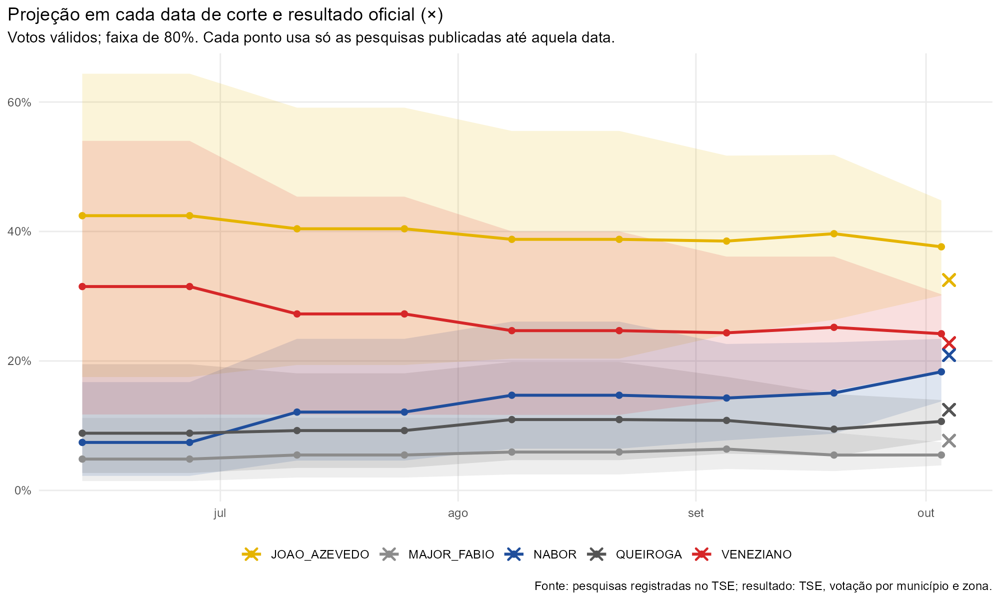

# Avaliação ex post contra o resultado oficial

Projeção com pesquisas publicadas até 03/10/2026, comparada com a votação oficial do TSE (04/10/2026).
Os parâmetros foram fixados antes desta comparação e não foram alterados por ela.

## Véspera

| Candidato | Projeção | Faixa 80% | Resultado | Erro | Na faixa | P(eleito) |
| --- | --- | --- | --- | --- | --- | --- |
| João Azevêdo | 37,6 | 30,1–44,9 | 32,5 | -5,1 | sim | 99,6 |
| Veneziano Vital do Rêgo | 24,2 | 18,5–30,3 | 22,8 | -1,4 | sim | 81,5 |
| Nabor Wanderley | 18,3 | 13,8–23,4 | 20,9 | 2,6 | sim | 18,8 |
| Marcelo Queiroga | 10,7 | 7,8–14,0 | 12,5 | 1,8 | sim | 0,2 |
| Major Fábio | 5,5 | 3,9–7,4 | 7,7 | 2,2 | não | 0,0 |
| André Gadelha | 1,9 | 1,3–2,6 | 2,8 | 0,9 | não | 0,0 |
| João Batista | 0,7 | 0,5–0,9 | 0,1 | -0,6 | não | 0,0 |
| Adriano Trajano | 0,5 | 0,3–0,6 | 0,1 | -0,4 | não | 0,0 |
| Rosilene Santana | 0,3 | 0,2–0,5 | 0,5 | 0,2 | não | 0,0 |
| Rinaldo Júnior | 0,3 | 0,2–0,5 | 0,2 | -0,1 | não | 0,0 |

Candidatos com curva própria dentro da faixa de 80%: 4 de 6.

## Cortes anteriores

| Corte | Pesquisas | Erro abs. médio (p.p.) | Cobertura 80% | Brier | P(eleito) dos eleitos |
| --- | --- | --- | --- | --- | --- |
| 13/06 | 13 | 6,5 | 83% | 0,005 | JOAO_AZEVEDO 92%; VENEZIANO 84% |
| 27/06 | 13 | 6,5 | 83% | 0,005 | JOAO_AZEVEDO 92%; VENEZIANO 84% |
| 11/07 | 15 | 4,4 | 100% | 0,010 | JOAO_AZEVEDO 91%; VENEZIANO 78% |
| 25/07 | 15 | 4,4 | 100% | 0,010 | JOAO_AZEVEDO 91%; VENEZIANO 78% |
| 08/08 | 16 | 3,0 | 100% | 0,018 | JOAO_AZEVEDO 91%; VENEZIANO 70% |
| 22/08 | 16 | 3,0 | 100% | 0,018 | JOAO_AZEVEDO 91%; VENEZIANO 70% |
| 05/09 | 21 | 3,0 | 100% | 0,009 | JOAO_AZEVEDO 96%; VENEZIANO 78% |
| 19/09 | 23 | 3,5 | 100% | 0,007 | JOAO_AZEVEDO 98%; VENEZIANO 82% |
| 03/10 | 35 | 2,4 | 67% | 0,007 | JOAO_AZEVEDO 100%; VENEZIANO 81% |

